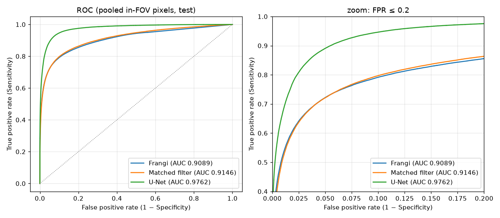
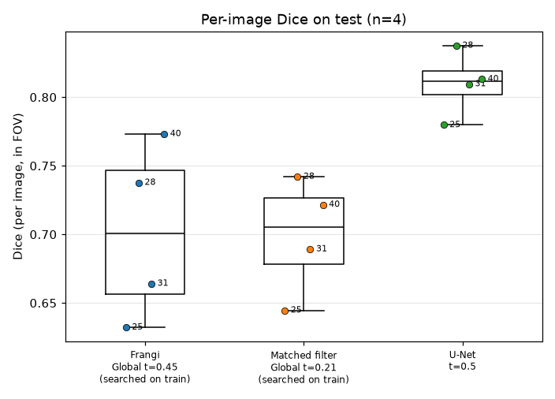
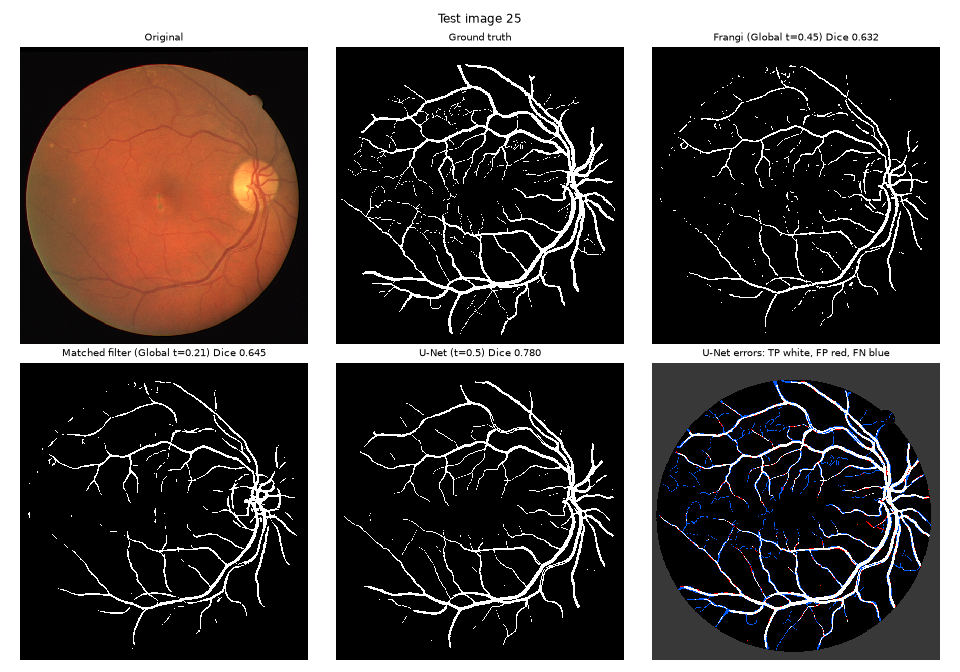
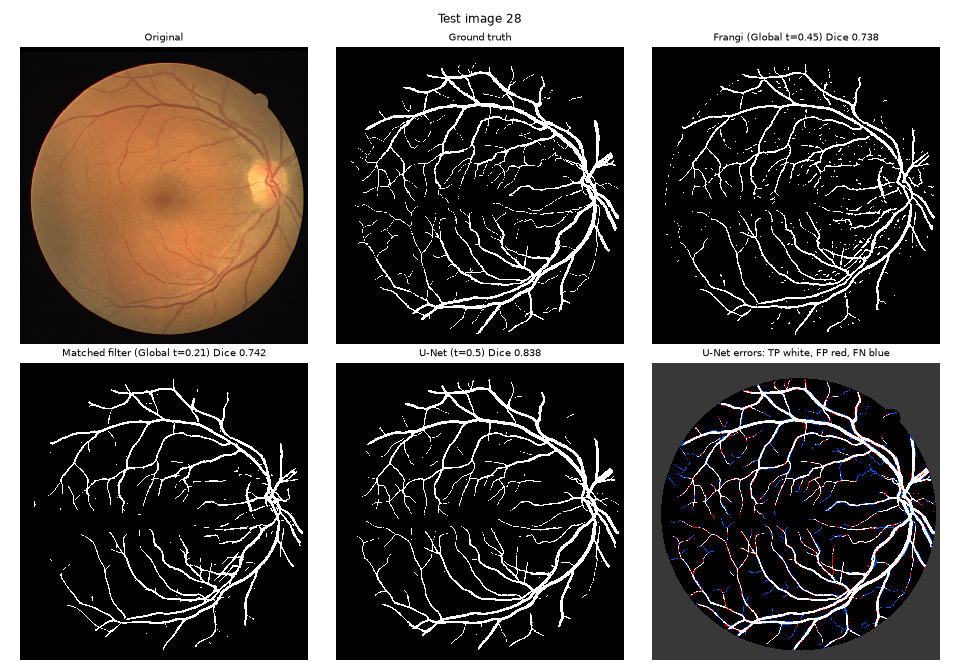
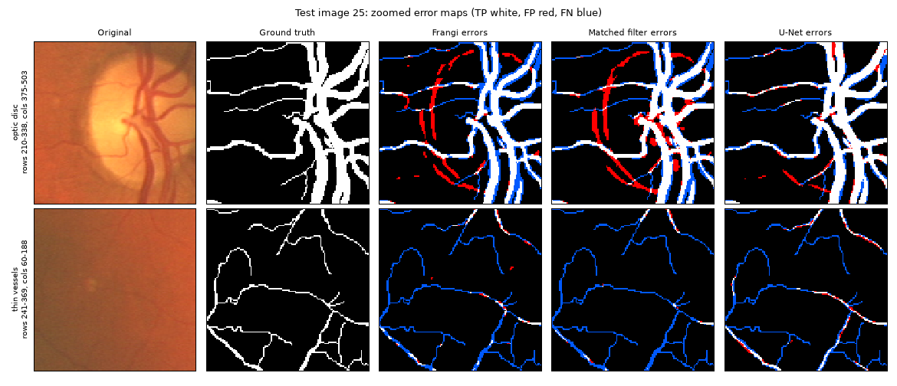
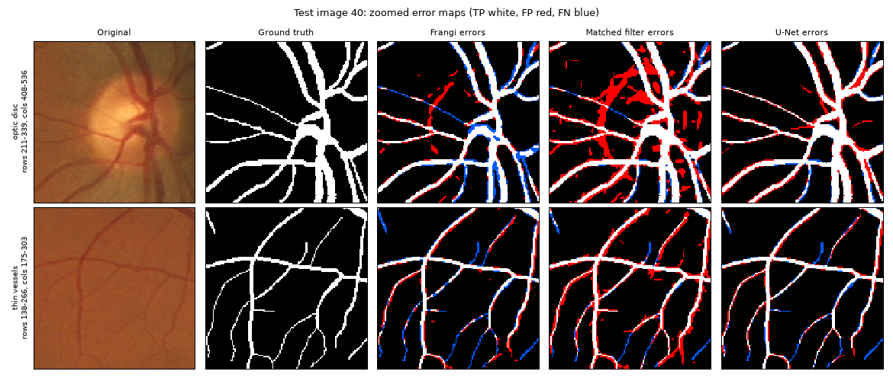

# vessel-seg：视网膜 / OCTA 血管分割

在 DRIVE 眼底图上对比经典血管增强方法（Frangi、匹配滤波）与手写 U-Net，
随后在不改动模型 / 训练 / 指标代码的前提下迁移到 OCTA 数据（ROSE 或 OCTA-500），
验证代码可复用性，并分析两类影像的噪声差异。

指标：Dice、Sensitivity、Specificity、Accuracy、AUC（DRIVE 上全部在 FOV mask 内计算）。

## 环境搭建（Apple Silicon Mac，uv）

```bash
# 1. 安装 uv（若未安装）
curl -LsSf https://astral.sh/uv/install.sh | sh

# 2. 安装 Python 3.11 并按 pyproject.toml / uv.lock 建立 .venv
cd vessel-seg
~/.local/bin/uv python install 3.11
~/.local/bin/uv sync

# 3. 验证设备（应输出 mps 并完成一次 conv 前向）
PYTORCH_ENABLE_MPS_FALLBACK=1 .venv/bin/python -m utils.device

# 4. 运行测试
.venv/bin/python -m pytest -q
```

数据：DRIVE 原始数据放在仓库外的 `../Drive/`，`data/DRIVE` 是指向它的相对软链接，
`data/` 不入 git。克隆后需自行创建：`ln -s ../../Drive data/DRIVE`。

## 可复现性说明

- 随机种子统一由 `utils/seed.py` 的 `set_seed()` 设置（random / numpy / torch，以及可用时的 mps / cuda）。
- **MPS（Apple GPU）上的结果不保证逐位（bit-exact）可复现**：部分算子的并行归约顺序不固定，
  即使种子相同，两次运行的指标也可能有微小差异。CPU 上固定种子可逐位复现。
- 全项目统一使用 float32（MPS 不支持 float64）。

## 数据划分（偏离计划书）

用户手中的 DRIVE 版本（原始发布包）**测试集（01–20）没有 `1st_manual` 金标准**，只有 images 与 FOV mask，
无法在官方测试集上计算指标。因此（用户决定）：

- train / val / test **全部从 20 张带标签的训练图（21–40）中划分**，大小 12 / 4 / 4；
- 划分由 `configs/drive.yaml` 中的 `data.split.seed`（当前 `2026`）唯一确定，逻辑见 `datasets/base.py::split_names`
  （对名字排序后用 `np.random.default_rng(seed)` 打乱，与目录顺序和全局随机状态无关）；
- 官方测试集图像不参与任何指标计算。

当前划分（seed = 2026）：

| split | 数量 | 图像编号 |
| --- | --- | --- |
| train | 12 | 21, 22, 23, 27, 29, 30, 32, 33, 34, 35, 36, 39 |
| val | 4 | 24, 26, 37, 38 |
| test | 4 | 25, 28, 31, 40 |

**注意**：本项目的"测试集"只有 4 张、且来自官方训练集，指标方差较大，
**不能与文献中在 DRIVE 官方 20 张测试集上报告的数字直接比较**，只能用于本项目内部方法之间的对比。

检查脚本：`.venv/bin/python -m datasets.drive`（打印各 split 数量/尺寸/名字，随机抽 3 张保存 label 叠加图到
`results/drive_check/<时间戳>/`）。

## 阶段一结果：经典 baseline（任务 1.2）

运行：`.venv/bin/python -m classical.run_baseline --config configs/drive.yaml`（CPU 约 20 秒，结果确定可复现）。

流程：绿通道 → CLAHE(clip 2.0, 8×8) → FOV 外填充（含 FOV 最外圈 5 像素）→ 高斯去噪(σ=1.5) →
Frangi（σ=1–3 步长 0.5，β=1.0，γ=0.006，black_ridges）/ 手写高斯匹配滤波（σ=1.0，L=13，12 方向取最大）→
FOV 内 min-max 归一化到 [0,1]（AUC 用它）→ Otsu（逐图）或全局阈值（在 train split 上最大化逐图平均 Dice 搜索，步长 0.01）。
所有参数都只在 train split（12 张）上调过，test 从未参与任何选择。

参数如何调的（可复现）：`.venv/bin/python -m classical.tune_baseline --config configs/drive.yaml`
（CPU 约 7 分钟）。脚本只读取 train split（读其他 split 直接抛异常，并按文件名核对与 val/test 不相交），
在 FOV 填充 `erode_px` ∈ {0,2,3,5,8} × 高斯 σ ∈ {1.0,1.5,2.0} × [Frangi `gamma` ∈ {auto,0.003,0.006,0.01,0.02} |
匹配滤波 σ ∈ {1.0,1.5,2.0,2.5} × L ∈ {7,9,11,13}] 上网格搜索（共 315 组），目标与 `run_baseline` 相同：
train 上搜索全局阈值后的逐图平均 Dice。结果在 `results/classical_tune/20261013-164439/`（grid_results.csv / .json）。
- Frangi：网格最优 erode 5 / σ 2.0 / γ 0.02 为 train Dice 0.7159，当前 config（erode 5 / σ 1.5 / γ 0.006）为 0.7071（排名 12/75）。
  差距不到 0.01，且最优组合的阈值落在 t=0.03、逐图 Otsu Dice 只有 0.4250（当前 0.7059），故保留当前 config。
- 匹配滤波：网格最优 σ=1.0、L=13 为 train Dice 0.7030，原 config（σ=1.5、L=11）为 0.6697（排名 49/240），
  12 张 train 图中 9 张提升，因此改为 σ=1.0、L=13（预处理不变）。两个值都在网格边缘。
  改动后的 val 全局阈值 Dice 从 0.7385 降到 0.7213，test 从 0.6734 升到 0.6994（均为改前/改后 run_baseline 的输出）。
- `run_baseline --splits train`（或 `train,val`）可只评估指定 split，完全不加载 test。

调参中发现并处理的问题：
- skimage Frangi 默认 `gamma=None`（取 Hessian 范数最大值的一半）时响应被少数极大值主导、分布极度右偏，
  train 上 Otsu Dice 只有约 0.3；固定 `gamma=0.006` 后 Otsu 与搜索阈值的 Dice 基本一致。
- DRIVE 的 FOV 掩膜边缘内侧有约 3 像素的暗边，被暗血管检测器当成血管，二值图上出现一整圈假阳性；
  对预处理图做"FOV 外（含最外圈 5 像素）逐圈邻域均值填充"后消失。指标仍在原始 FOV 内计算。
- 极性检查：train 图 21 上 Frangi `black_ridges=True` 的 AUC 为 0.934，误设为 False 时为 0.225。

test split（4 张；指标表原样复制自 `results/classical_drive/20261013-165209/metrics.md`）：

| Method | Threshold | Dice | Sensitivity | Specificity | Accuracy | AUC | Global Dice | Global AUC |
| --- | --- | --- | --- | --- | --- | --- | --- | --- |
| Frangi | Otsu (per image) | 0.7027 ± 0.0544 | 0.6869 ± 0.0901 | 0.9676 ± 0.0161 | 0.9322 ± 0.0117 | 0.9150 ± 0.0264 | 0.7042 | 0.9089 |
| Frangi | Global (searched on train), t=0.45 | 0.7018 ± 0.0562 | 0.6665 ± 0.1009 | 0.9726 ± 0.0132 | 0.9342 ± 0.0117 | 0.9150 ± 0.0264 | 0.7039 | 0.9089 |
| Matched filter | Otsu (per image) | 0.6279 ± 0.0728 | 0.4856 ± 0.0911 | 0.9938 ± 0.0024 | 0.9322 ± 0.0176 | 0.9357 ± 0.0190 | 0.6283 | 0.9146 |
| Matched filter | Global (searched on train), t=0.21 | 0.6994 ± 0.0368 | 0.6748 ± 0.1295 | 0.9693 ± 0.0218 | 0.9327 ± 0.0103 | 0.9357 ± 0.0190 | 0.7026 | 0.9146 |

val split（4 张，同上来源）：

| Method | Threshold | Dice | Sensitivity | Specificity | Accuracy | AUC | Global Dice | Global AUC |
| --- | --- | --- | --- | --- | --- | --- | --- | --- |
| Frangi | Otsu (per image) | 0.7342 ± 0.0288 | 0.7032 ± 0.0536 | 0.9682 ± 0.0098 | 0.9318 ± 0.0056 | 0.9221 ± 0.0156 | 0.7362 | 0.9207 |
| Frangi | Global (searched on train), t=0.45 | 0.7345 ± 0.0289 | 0.6902 ± 0.0538 | 0.9716 ± 0.0089 | 0.9331 ± 0.0057 | 0.9221 ± 0.0156 | 0.7366 | 0.9207 |
| Matched filter | Otsu (per image) | 0.6526 ± 0.0268 | 0.5063 ± 0.0391 | 0.9937 ± 0.0030 | 0.9271 ± 0.0114 | 0.9410 ± 0.0120 | 0.6516 | 0.9175 |
| Matched filter | Global (searched on train), t=0.21 | 0.7213 ± 0.0387 | 0.7497 ± 0.0818 | 0.9500 ± 0.0338 | 0.9211 ± 0.0182 | 0.9410 ± 0.0120 | 0.7182 | 0.9175 |

可视化对比图：`results/classical_drive/20261013-165209/figures/compare_{25,28,31,40}.png`（原图 / 绿通道 / 预处理后 / 金标准 / 两种滤波的响应与全局阈值二值图）。
连续响应 `.npy`（float32，FOV 内归一化）保存在 `results/classical_drive/20261013-165209/maps/test/`，供任务 1.5 画 ROC。

## 阶段一结果：U-Net（任务 1.4）

运行：

```bash
.venv/bin/python -m scripts.train --config configs/drive.yaml --overfit 2   # 过拟合测试（train 前 2 张，无增强）
.venv/bin/python -m scripts.train --config configs/drive.yaml               # 完整训练（train 12 张，val 4 张早停）
.venv/bin/python -m scripts.test  --config configs/drive.yaml --ckpt results/unet_drive_train/<时间戳>/best.pth
```

设置（`configs/drive.yaml` 的 `unet` / `train` / `infer` 小节）：绿通道 + CLAHE(2.0, 8×8) 归一化到 [0,1]（不去噪、不做 FOV 外填充）→
手写 U-Net（4 次下采样，基础通道 32，参数 7,762,465）；每 epoch 每张训练图随机采 200 个 96×96 patch（80% 中心落在 FOV 内），
增强为翻转 / 90° 旋转 / ±15° 旋转 / 亮度对比度扰动；BCE + soft Dice（Dice 只在 FOV 内）各权重 1；AdamW(lr 1e-3, wd 1e-4)，
3 epoch warmup + 余弦退火到 1e-5，梯度裁剪 1.0，batch 32；每 epoch 在 val 上做 96×96 / stride 32 滑窗推理并在 FOV 内算指标，
early stopping 监控 val 逐图平均 Dice（patience 25，min_delta 0.0005）。超参数未在 test 上调过（首次训练即达标，没有再调）。

- 过拟合测试（2 张图 21、22，30 epoch，`results/unet_drive_overfit/20261013-161456/`）：训练 loss 1.4812 → 0.3827，
  这 2 张图上整图 Dice 0.0000（epoch 1）→ 0.8852（最佳 epoch 28）。
- 完整训练（`results/unet_drive_train/20261013-161717/`）：最大 150 epoch，在 epoch 69 早停，最佳 epoch 44（val Dice 0.8308），
  墙钟时间 1374.8 s（约 22.9 分钟，Apple M4 / MPS）。曲线见 `curves.png`（已按早停实际保存的最佳 epoch 44 重画；原图标注的是 val Dice 的 argmax epoch 52，其提升 < min_delta，未被保存），逐 epoch 记录见 `history.csv`。

test split（4 张；表格原样复制自 `results/unet_drive/20261013-164103/metrics.md`）：

| Split | Threshold | Dice | Sensitivity | Specificity | Accuracy | AUC | Global Dice | Global AUC |
| --- | --- | --- | --- | --- | --- | --- | --- | --- |
| test | 0.5 | 0.8100 ± 0.0205 | 0.8006 ± 0.0738 | 0.9783 ± 0.0084 | 0.9558 ± 0.0066 | 0.9783 ± 0.0063 | 0.8109 | 0.9762 |
| test | best-val t=0.38 | 0.8105 ± 0.0175 | 0.8218 ± 0.0677 | 0.9742 ± 0.0090 | 0.9549 ± 0.0054 | 0.9783 ± 0.0063 | 0.8119 | 0.9762 |
| val | 0.5 | 0.8308 ± 0.0102 | 0.8087 ± 0.0338 | 0.9789 ± 0.0061 | 0.9555 ± 0.0048 | 0.9811 ± 0.0024 | 0.8313 | 0.9803 |
| val | best-val t=0.38 | 0.8322 ± 0.0105 | 0.8311 ± 0.0326 | 0.9746 ± 0.0067 | 0.9548 ± 0.0046 | 0.9811 ± 0.0024 | 0.8328 | 0.9803 |

"best-val" 阈值只在 val 上搜索后原样用于 test。概率图 `.npy` 在 `probs/`，阈值 0.5 二值图（FOV 外置 0）在 `pred/`。
**MPS 上训练不保证逐位可复现**：同样的 config 与种子重跑，指标可能有小幅差异；上表是这一次运行的结果。

## 阶段一结果：方法对比（任务 1.5）

运行：`.venv/bin/python -m eval.evaluate --config configs/drive.yaml`（几秒；来源目录写在 config 的 `compare` 小节，
也可用 `--classical-dir` / `--unet-dir` 覆盖）。`eval/evaluate.py` 不重跑任何方法，而是读取经典 baseline
（`results/classical_drive/20261013-165209/maps/test/*.npy`）与 U-Net 测试（`results/unet_drive/20261013-164103/probs/*.npy`）
保存的连续分数图，用 `eval/metrics.py` 和数据集的 label / FOV 重新计算全部指标，再与两个来源 run 的 `metrics.json`
逐项比对（容差 1e-6，6 行实测最大绝对差均为 0）。结果目录：`results/compare_drive/20261013-170110/`。

**阈值**：主表中经典方法用在 train split 上搜索的全局阈值（Frangi t=0.45、匹配滤波 t=0.21），U-Net 用 0.5；
三者都在训练数据上确定后原样用于 test。Otsu（逐图）与 U-Net 在 val 上搜索的阈值放在副表。AUC 与阈值无关。

test split（4 张，FOV 内；以下表格原样复制自 `results/compare_drive/20261013-170110/metrics.md`）：

| Method | Threshold | Dice | Sensitivity | Specificity | Accuracy | AUC | Global Dice | Global AUC |
| --- | --- | --- | --- | --- | --- | --- | --- | --- |
| Frangi | Global t=0.45 (searched on train) | 0.7018 ± 0.0562 | 0.6665 ± 0.1009 | 0.9726 ± 0.0132 | 0.9342 ± 0.0117 | 0.9150 ± 0.0264 | 0.7039 | 0.9089 |
| Matched filter | Global t=0.21 (searched on train) | 0.6994 ± 0.0368 | 0.6748 ± 0.1295 | 0.9693 ± 0.0218 | 0.9327 ± 0.0103 | 0.9357 ± 0.0190 | 0.7026 | 0.9146 |
| U-Net | t=0.5 | 0.8100 ± 0.0205 | 0.8006 ± 0.0738 | 0.9783 ± 0.0084 | 0.9558 ± 0.0066 | 0.9783 ± 0.0063 | 0.8109 | 0.9762 |

副表（Otsu 与 U-Net val 搜索阈值）：

| Method | Threshold | Dice | Sensitivity | Specificity | Accuracy | AUC | Global Dice | Global AUC |
| --- | --- | --- | --- | --- | --- | --- | --- | --- |
| Frangi | Otsu (per image) | 0.7027 ± 0.0544 | 0.6869 ± 0.0901 | 0.9676 ± 0.0161 | 0.9322 ± 0.0117 | 0.9150 ± 0.0264 | 0.7042 | 0.9089 |
| Matched filter | Otsu (per image) | 0.6279 ± 0.0728 | 0.4856 ± 0.0911 | 0.9938 ± 0.0024 | 0.9322 ± 0.0176 | 0.9357 ± 0.0190 | 0.6283 | 0.9146 |
| U-Net | t=0.38 (searched on val) | 0.8105 ± 0.0175 | 0.8218 ± 0.0677 | 0.9742 ± 0.0090 | 0.9549 ± 0.0054 | 0.9783 ± 0.0063 | 0.8119 | 0.9762 |

逐图 Dice（主表阈值）：

| Method | 25 | 28 | 31 | 40 |
| --- | --- | --- | --- | --- |
| Frangi | 0.6322 | 0.7377 | 0.6641 | 0.7732 |
| Matched filter | 0.6446 | 0.7421 | 0.6892 | 0.7216 |
| U-Net | 0.7797 | 0.8376 | 0.8096 | 0.8131 |

图（`docs/figures/` 是从结果目录复制出的入库副本；4 张测试图的完整图在 `results/compare_drive/20261013-170110/`）：

| ROC（FOV 内像素跨图汇总） | 逐图 Dice |
| --- | --- |
|  |  |

典型样例（U-Net Dice 最低的 25 与最高的 28）：原图 / 金标准 / Frangi / 匹配滤波 / U-Net / U-Net 错误图（TP 白、FP 红、FN 蓝、FOV 外暗灰）：




局部放大（上行：视盘区域；下行：细血管像素最密的窗口），三种方法的错误图：




补充分析（`results/compare_drive/20261013-170110/metrics.md`；细血管 = 金标准局部半径 ≤ 1.5 像素，视盘 = 启发式检测中心、半径 45 像素的圆；
区域是启发式定义，只用于解释差异，不是正式指标）：

| Method | Sens（细血管） | Sens（粗血管） | FP 总数 | 视盘圆内 FP | 视盘内 FP 占比 |
| --- | --- | --- | --- | --- | --- |
| Frangi | 0.5087 | 0.7140 | 22171 | 2256 | 0.102 |
| Matched filter | 0.4692 | 0.7457 | 24720 | 3537 | 0.143 |
| U-Net | 0.6136 | 0.8653 | 17466 | 936 | 0.054 |

分析（基于上面的表与图）：

- **整体**：U-Net 在全部 5 项逐图指标和 Global Dice / AUC 上都高于两种经典方法（Dice 0.8100 vs 0.7018 / 0.6994，
  AUC 0.9783 vs 0.9150 / 0.9357），且 4 张测试图中每一张的 U-Net Dice 都高于两种经典方法（逐图表）。
  ROC 上 U-Net 曲线在整个 FPR 范围内都在两条经典曲线之上，FPR ≤ 0.2 的放大图中差距最明显；
  Frangi 与匹配滤波两条曲线几乎重合。U-Net 的图间波动也更小（Dice std 0.0205 vs 0.0562 / 0.0368）。
- **细血管**：三种方法的细血管召回率都明显低于粗血管，但 U-Net 的细血管召回率最高（0.6136 vs Frangi 0.5087、
  匹配滤波 0.4692）。放大图下行可见：经典方法在细血管处大段漏检（蓝色），U-Net 能连续地找回更多细分支，
  但最细、最低对比度的毛细分支三者都会漏。
- **视盘**：经典方法在视盘边缘产生明显的弧形假阳性——视盘的亮边界在暗血管检测器看来就是一条"暗-亮"
  阶跃 / 脊（图 25 视盘周围的红色弧线，图 40 匹配滤波在视盘内的大片红色）。视盘圆内的 FP 像素数：
  Frangi 2256、匹配滤波 3537、U-Net 936。U-Net 从数据中学到了"视盘边缘不是血管"。
- **背景纹理**：Frangi 在部分图上把背景（脉络膜）纹理检测成大量短小碎片（例如图 31 的 Frangi 二值图下半部分），
  这是 Hessian 线状度量对局部明暗纹理敏感的结果；U-Net 输出的血管树更干净、更连贯。
- **U-Net 的主要误差**：FN（蓝）集中在细血管与血管末梢；FP（红）多为粗血管两侧的一圈边缘（预测略粗于金标准，
  图 40 的放大图最明显），以及少量把细小结构连起来的假分支。阈值从 0.5 换成 val 上选的 0.38 后
  Sens 升、Spec 降，Dice 几乎不变（0.8100 → 0.8105）。
- **经典方法的阈值敏感性**：匹配滤波用 Otsu 时 Dice 只有 0.6279（Sens 0.4856），用 train 上搜索的全局阈值时为 0.6994；
  Frangi 两种阈值几乎相同（0.7027 / 0.7018）。

**注意**：test 只有 4 张图，且来自 DRIVE 官方训练集（见"数据划分"），mean ± std 只基于 4 个样本，
差异的统计意义有限；数字不能与文献中在官方 20 张测试集上报告的结果直接比较。

## 官方测试集提交（grand-challenge DRIVE）

DRIVE 官方 20 张测试图（`data/DRIVE/test/images/01_test.tif … 20_test.tif`）没有标签，只能提交到
grand-challenge 评分。`scripts/predict_submission.py` 生成提交包：zip 根目录下恰好 `1.png … 20.png`
（`01_test.tif` → `1.png`，无前导零），每张为 584×565 的 8 位单通道 PNG，取值 {0,255}，FOV 外置 0。

```bash
python -m scripts.predict_submission --config configs/drive.yaml \
    --ckpt results/unet_drive_train/20261013-161717/best.pth \
    --images-dir data/DRIVE/test/images --mask-dir data/DRIVE/test/mask
# 输出 results/submission_drive/<时间戳>/：png/、probs/*.npy、manifest.json、drive_submission.zip
```

- **预处理**取自 checkpoint 记录（`config.unet.preprocess`），滑窗参数取 config 的 `infer`，与训练/测试完全相同；
  脚本不经过带标签的 Dataset 接口，直接调用 `classical.preprocess` 与 `eval.infer`。
- **阈值**默认读 `submission.threshold_from`（`results/unet_drive/20261013-164103/metrics.json`）中的
  `best_val_threshold` = 0.38——只在 val split（4 张）上选出，官方测试集不参与任何选择；`--threshold` 可覆盖，
  文件缺失时退回 0.5 并打印提示。
- **PNG 管线核对**：用同一脚本处理 4 张带标签的 held-out 图（`--images-dir data/DRIVE/training/images
  --mask-dir data/DRIVE/training/mask --ids 25 28 31 40`），由写出的 PNG 在 FOV 内重算 Dice，
  与 `results/unet_drive/20261013-164103/metrics.json` 中 t=0.38 的 test 结果逐图一致（均值 0.8105，差 0）。
- **注意**：模型只用 12 张图训练（见"数据划分"），而文献通常用官方 20 张训练图；官方测试集上的得分在用户提交前未知，
  不能用本仓库 4 张 held-out 图的 Dice 代替。

## 阶段二注意事项（来自任务 1.4 复查与阶段一收尾的已知约束）

- **预处理只产出单通道**：`classical/preprocess.py` 的输出是 H×W 单通道图；`unet.in_channels > 1`（如直接喂 RGB 或多层 OCTA）
  在不修改 train/ 的情况下不受支持。OCTA 本身是单通道，`green_channel: false` 即可。
- **CLAHE 会量化到 uint8**：OpenCV 的 CLAHE 只接受 uint8 / uint16，实现中先量化到 uint8 再转回 float32；
  对 16 位 OCTA 数据会损失灰度分辨率（关闭 CLAHE 则不受影响）。
- **图像尺寸必须 ≥ 训练 patch 大小**：`train/patch_dataset.py` 对小于 `patch_size` 的图直接报错（滑窗推理会补边，不受此限）；
  OCTA 图若较小需相应调小 `train.patch_size` / `infer.patch_size`。
- **`split_names` 要求各 split 大小之和等于样本总数**（否则报错；`allow_unused=True` 才允许不用完）。ROSE 有官方 train/test 划分，
  应在适配器内部处理（例如官方 test 作为 test、从官方 train 中划出 val），而不是依赖 DRIVE 那套 12/4/4 随机划分。
- **val split 必须非空**：训练每个 epoch 都在 val 上算 Dice 供 early stopping 使用，空 val 会在汇总指标时报错。
- checkpoint 现在记录训练时的 `preprocess` 与 `data_name`，`scripts/test.py` 发现与当前 config 不一致时会打印警告；
  跨数据集测试（如用 DRIVE 权重测 OCTA）会被提示。
- **所有入口只经注册表取数据**：`classical/run_baseline.py`、`classical/tune_baseline.py`、`scripts/train.py`、`scripts/test.py`、
  `eval/evaluate.py` 都只调用 `datasets.build_dataset(cfg, split)`，不出现 `DRIVEDataset`。接入 OCTA 时新增
  `datasets/rose.py` 并在 `datasets/__init__.py::DATASETS` 里登记一行，再写 `configs/rose.yaml` 即可。
  `tune_baseline` 的"只读 train"检查也只依赖基类的 `.names`（构造 val/test 数据集对象取名单，不读其图像），无 DRIVE 文件名逻辑。
  经典 baseline 图表标题与指标表标题由 config（`experiment`、`preprocess`）生成。
- **补充分析默认关闭**：`eval/evaluate.py` 的细 / 粗血管召回率由 `compare.supplementary` 开启，视盘区域 FP 与视盘局部放大图
  另由 `compare.supplementary_optic_disc` 开启；两者缺省均为 false（`configs/drive.yaml` 显式设为 true）。
  OCTA 没有视盘，`rose.yaml` 不要开 `supplementary_optic_disc`；若开 `supplementary`，分母为 0 的比值（如全是细血管时的粗血管召回率）
  记为 NaN、表中显示 n/a，不会崩溃。局部放大图在小图上自动缩小裁剪框。
- **迁移演练测试**：`tests/test_portability.py` 在测试内定义一个假的单通道数据集（128×144、全 1 FOV、1 像素宽血管），
  用 monkeypatch 临时登记进注册表（不进入真实 `DATASETS`），配一个临时 config，依次调用 `classical.run_baseline`、
  `scripts.train`（1 epoch 小 U-Net）、`scripts.test`、`eval.evaluate` 的 `main`，全部跑通——即阶段二只需"适配器 + config"。

## 目录结构

```
configs/    实验配置（drive.yaml, rose.yaml）
data/       原始数据（软链接，不入 git）
datasets/   Dataset 适配类
classical/  经典方法：预处理、Frangi / 匹配滤波、baseline 脚本
models/     手写 U-Net
train/      增强、损失、训练循环、early stopping
eval/       指标、评估、可视化
utils/      设备选择、随机种子、IO
scripts/    train.py, test.py, predict_submission.py 入口
results/    实验输出（按 实验名/时间戳，不入 git）
docs/       入库的 README 配图（docs/figures/，从 results/ 复制）
tests/      单元测试
```

## 进度

| 日期 | 任务 | 结果 |
| --- | --- | --- |
| 2026-10-13 | §1 环境 + §2 仓库结构 | 通过。uv 0.13.0 + Python 3.11.17，torch 2.14.1 / torchvision 0.29.1；`python -m utils.device` 输出 `mps`，Conv2d 前向 (2,1,64,64)→(2,8,64,64) float32 成功；pytest 2 passed |
| 2026-10-13 | 任务 1.1 数据准备 | 通过。测试集无标签，按用户决定从 20 张训练图划分 12/4/4（seed=2026）；三个 split 图像均为 H×W=584×565（RGB），label/FOV 二值化为 {0,1}，FOV 外血管像素占比最大 0.28%；叠加图 3 张（21、24、36）保存于 results/drive_check/20261013-154805/；pytest 8 passed |
| 2026-10-13 | 任务 1.3 指标模块 | 通过（先于 1.2 执行，因 1.2 的 baseline 评估依赖本模块）。`eval/metrics.py` 手写 TP/FP/TN/FN（整数计数，仅 FOV 内）及 Dice/Sens/Spec/Acc，AUC 用 `roc_auc_score`（单类返回 NaN）；`MetricAccumulator` 同时给出逐图 mean±std 与整体像素级结果；分母为 0 约定见模块 docstring。DRIVE val 4 张图 label vs label：5 项指标逐图与整体均为 1.0000（整体 TP=123029, TN=783199, FP=FN=0）；pytest 29 passed（新增 21 个指标测试） |
| 2026-10-13 | 任务 1.2 经典 baseline | 通过（Dice 在 0.6–0.75 参考范围内）。test（4 张，逐图 mean）：Frangi+Otsu Dice 0.7027、Frangi+全局阈值(t=0.45) Dice 0.7018，Frangi AUC 0.9150；匹配滤波+Otsu Dice 0.6474、匹配滤波+全局阈值(t=0.28) Dice 0.6734，匹配滤波 AUC 0.9374。参数与全局阈值只在 train split 上选；结果于 results/classical_drive/20261013-160705/（metrics.md/csv/json、maps/test、figures/compare_*.png）；pytest 43 passed（MF 数值已被"1.2 补充"取代）|
| 2026-10-13 | 任务 1.4 U-Net | 通过（test Dice ≥ 0.78）。test（4 张，阈值 0.5，逐图 mean）Dice 0.8100、Sens 0.8006、Spec 0.9783、Acc 0.9558、AUC 0.9783；val 上选的阈值 t=0.38 时 test Dice 0.8105。训练 69 epoch（epoch 69 早停，最佳 epoch 44，val Dice 0.8308），墙钟 1374.8 s（约 22.9 分钟，MPS）；过拟合测试 2 张图 loss 1.4812→0.3827、Dice 0.8852。结果：results/unet_drive_train/20261013-161717/（best.pth、曲线、history）、results/unet_drive/20261013-164103/（metrics.md/csv/json、probs、pred）。MPS 不保证逐位可复现；pytest 67 passed |
| 2026-10-13 | 任务 1.2 补充：调参可复现 | 通过。新增 `classical/tune_baseline.py`（只读 train，315 组网格，结果 results/classical_tune/20261013-164439/）与 `run_baseline --splits`。Frangi 保留当前参数（train Dice 0.7071，网格最优 0.7159 但 Otsu 退化）；匹配滤波 σ 1.5→1.0、L 11→13（train Dice 0.6697→0.7030）。重跑 run_baseline（results/classical_drive/20261013-165209/）：test 匹配滤波+全局阈值(t=0.21) Dice 0.6994、Otsu 0.6279、AUC 0.9357，Frangi 不变（0.7018 / 0.7027 / 0.9150）；val 匹配滤波+全局阈值 Dice 0.7213；pytest 70 passed |
| 2026-10-13 | 任务 1.5 对比报告 | 通过。`eval/evaluate.py` 从已保存的响应图/概率图重算 test 指标，与来源 metrics.json 6 行逐项一致（最大差 0）；主表（test 4 张，逐图 mean）Dice / AUC：Frangi(t=0.45) 0.7018 / 0.9150，匹配滤波(t=0.21) 0.6994 / 0.9357，U-Net(t=0.5) 0.8100 / 0.9783；ROC、逐图 Dice 箱线图、样例与局部放大错误图见 results/compare_drive/20261013-170110/ 与 docs/figures/。同时完成阶段一加固（曲线最佳 epoch 与早停一致；checkpoint 记录预处理配置）；pytest 85 passed |
| 2026-10-13 | 阶段一收尾：迁移阻碍修复 | 通过。`classical/run_baseline.py`、`classical/tune_baseline.py` 改用 `datasets.build_dataset`（tune 的 train-only 检查改为与 val/test 数据集对象的 `.names` 比对，不读其图像）；经典 baseline 的图/表标题改由 config 生成；`eval/evaluate.py` 补充分析加开关 `compare.supplementary` / `compare.supplementary_optic_disc`（缺省 false，drive.yaml 为 true），所有比值分母为 0 时记 NaN（显示 n/a），修复粗血管像素为 0 时的 ZeroDivisionError；`eval/visualize.py` 视盘放大图可关、小图裁剪框自适应；`run_baseline.main` / `scripts.test.main` 返回结果目录。新增 `tests/test_portability.py`（假单通道数据集端到端：经典 baseline → 1 epoch U-Net 训练 → 测试 → 对比）。回归：重跑 run_baseline（results/classical_drive/20261013-171320/）与 evaluate（results/compare_drive/20261013-171334/），metrics.md 与 metrics.csv 分别与 results/classical_drive/20261013-165209/、results/compare_drive/20261013-170110/ 逐字节一致（`diff` 无输出）。用错配 config 做的无效验证 run results/unet_drive/20261013-170505 已移出 results/；pytest 91 passed |
| 2026-10-13 | 官方测试集提交包 | 通过。新增 `scripts/predict_submission.py`（不依赖标签，预处理取自 checkpoint，阈值 0.38 读自 results/unet_drive/20261013-164103/metrics.json 的 best_val_threshold）。生成 results/submission_drive/20261013-181546/drive_submission.zip：根目录恰好 1.png…20.png，均为 L 模式 584×565、取值 {0,255}、FOV 外 0 像素；FOV 内血管占比 0.1117–0.1580（1、2、11、19 号 >0.14）。同脚本在 held-out 25/28/31/40 上由 PNG 重算 Dice 逐图与 scripts.test 的 t=0.38 结果一致（均值 0.8105，差 0）。官方测试集得分待用户提交后才知道；pytest 97 passed |
